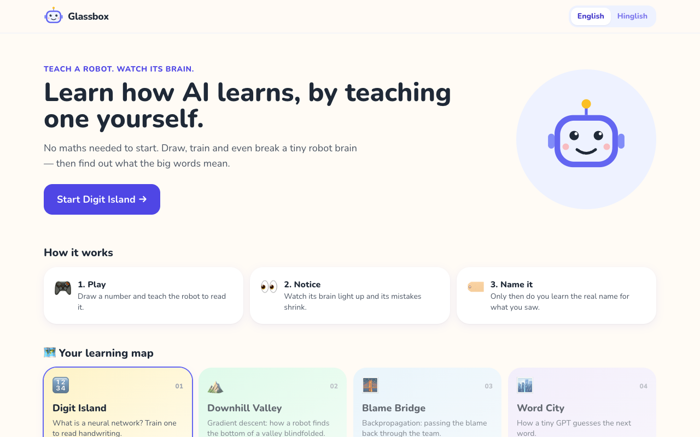
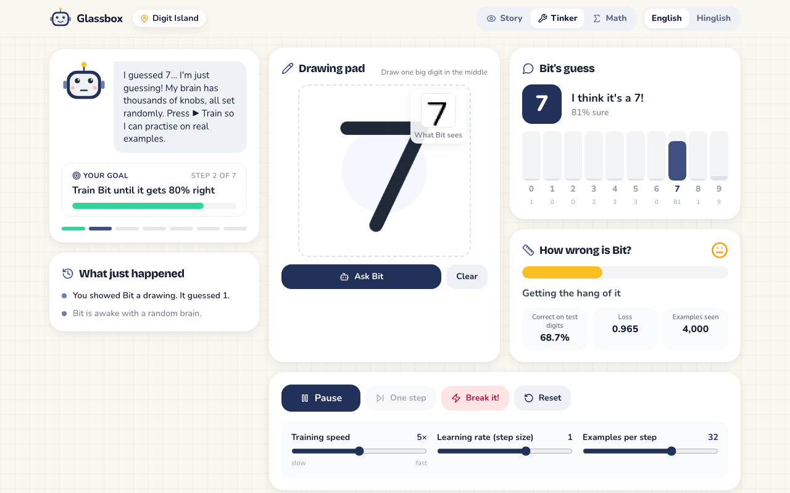
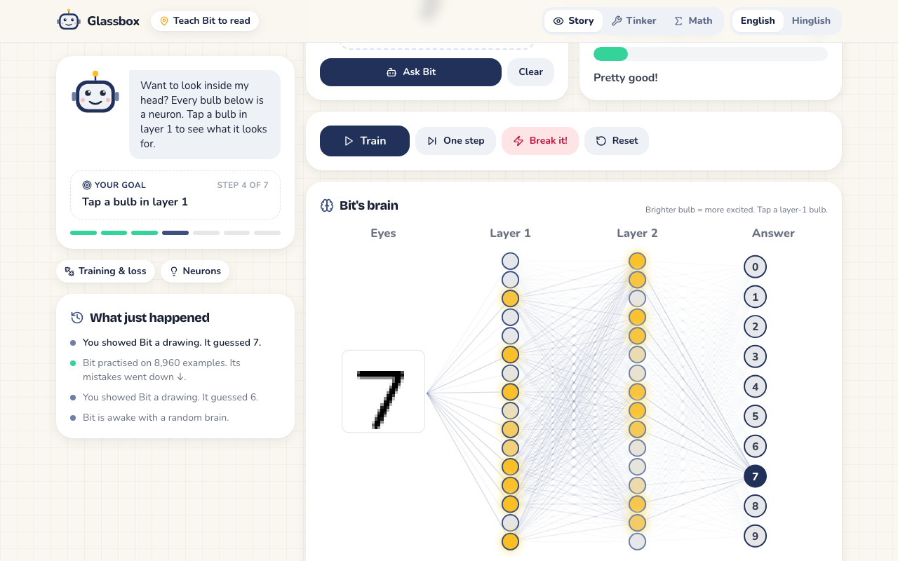
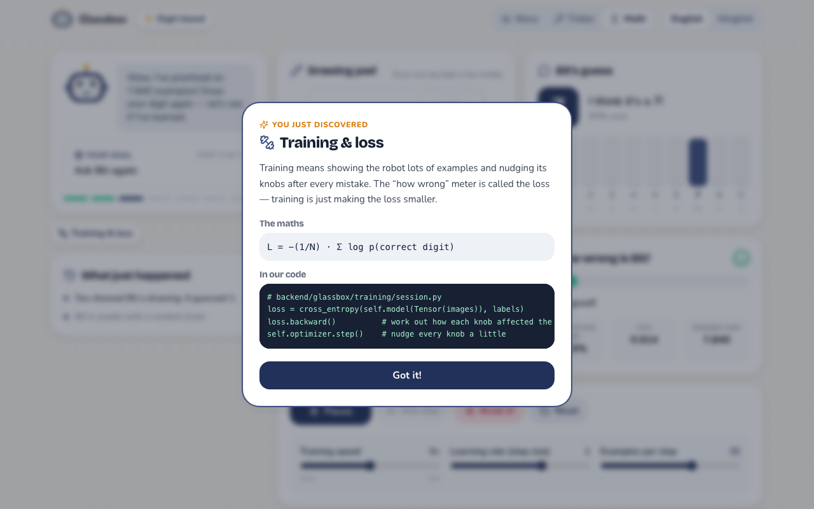
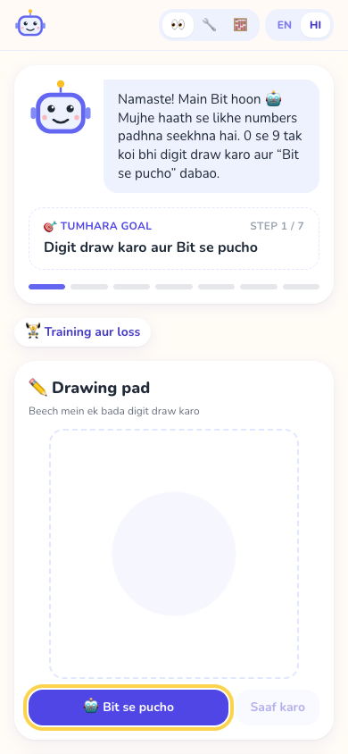

# Glassbox

**Teach a robot. Watch its brain.**

**Live demo: [glassbox-neeraj.vercel.app](https://glassbox-neeraj.vercel.app)**
(the API runs on a free server that sleeps when idle, so the first visit can take up to a minute)

Glassbox is an interactive, beginner-first playground for understanding how
neural networks learn. Instead of starting with formulas, you draw a digit,
train a small network to read it, look inside its "brain", break it on
purpose and fix it — and only *then* learn the real name for what you saw.



## Why

- Most explanations of neural networks start with `σ(Wx + b)` and lose
  beginners in minutes.
- Tools that let you *play* usually stop at toy 2D datasets, while real
  frameworks hide everything behind `loss.backward()`.
- Almost nothing interactive exists in Hindi/Hinglish.

Glassbox fixes this with three ideas:

1. **Play → notice → name.** Every concept is experienced before it is named.
2. **One screen, three depths.** 👀 Story (pictures only), 🔧 Tinker (sliders
   and real numbers) and 🧮 Math (formulas plus the engine code behind them).
3. **Built from scratch.** The network runs on a small NumPy autograd engine,
   so every number on screen traces back to readable code.

## Digit Island

The first island follows the classic 784 → 16 → 16 → 10 network for
handwritten digits. Bit the robot guides you through seven steps:

| Step | You do | You discover |
|---|---|---|
| 1 | Draw a digit and ask Bit | Bit is just guessing |
| 2 | Press ▶ Train until 80% correct | **Training & loss** |
| 3 | Ask again | **Neurons** |
| 4 | Tap a bulb to see its 784 knobs | **Weights** |
| 5 | Press 💥 Break it! | **Learning rate** |
| 6 | Reset Bit's brain | |
| 7 | Train to 90% correct | **Gradient descent** |

| Tinker mode while training | Inside Bit's brain |
|---|---|
|  |  |

| Math mode concept card | On a phone, in Hinglish |
|---|---|
|  |  |

## Quick start

Requirements: **Python 3.11+**, **Node 20+**, `make`.

```bash
git clone <this repo> glassbox
cd glassbox
make setup      # creates backend/.venv and installs npm packages
make dev        # starts the API (:8000) and the app (:5173)
```

Open **http://localhost:5173**. The first robot you create downloads MNIST
(about 11 MB) into `backend/.data/` — run `make data` beforehand to do it
up front.

Prefer two terminals?

```bash
make api        # terminal 1 → http://127.0.0.1:8000/docs
make web        # terminal 2 → http://localhost:5173
```

## Development

```bash
make test       # pytest + vitest
make lint       # ruff + TypeScript type-check
make build      # production frontend build
```

Configuration is read from `GLASSBOX_*` environment variables — see
[`backend/.env.example`](backend/.env.example).

## Deployment

The live demo is split across two free hosts:

- **Frontend** on Vercel: a static Vite build. `VITE_API_URL` is set at build
  time to the API's address, and the REST client and the WebSocket both use it.
- **API** on Render (Python web service, root `backend/`):
  - build: `pip install -r requirements.txt && python -m glassbox.data.mnist .data/mnist`
    (MNIST is downloaded once at build time, not on the first visit)
  - start: `uvicorn glassbox.api.main:app --host 0.0.0.0 --port $PORT`
  - health check: `/api/health`
  - `GLASSBOX_CORS_ORIGINS` lists the frontend's address as a JSON array.

Training sessions live in the API process's memory, so the API needs a
long-running server with WebSocket support rather than serverless functions.

## Project structure

```
backend/
  glassbox/engine/     NumPy autograd: Tensor, layers, losses, optimizers, gradcheck
  glassbox/data/       MNIST download + IDX parsing, mini-batch sampler
  glassbox/training/   the digit network, live sessions, session registry
  glassbox/api/        FastAPI app: REST + WebSocket training stream
  tests/               pytest suite (engine, data, sessions, API, stream)
frontend/
  src/pages/           Home and Digit Island
  src/missions/        mission state machine (pure, unit-tested)
  src/components/      guide, drawing pad, brain view, meter, chart, concept cards…
  src/i18n/            English + Hinglish copy
docs/
  ARCHITECTURE.md      how the pieces fit together
  ROADMAP.md           the islands still to come
  decisions/           architecture decision records
```

## Roadmap

Digit Island is the first of eight islands — next up are gradient descent,
backpropagation, a tiny GPT, attention, how models store facts,
cross-entropy and diffusion. See [docs/ROADMAP.md](docs/ROADMAP.md).

## License

[MIT](LICENSE)
